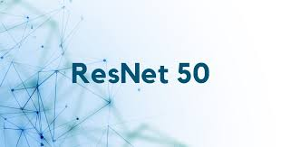

<div align="center">

# 🔍 ImageNet Vision — ResNet-50 Deep Learning Engine

<p align="center">
  
</p>

### *Next-Generation Image Classification Web Application powered by 50-Layer Deep Convolutional Residual Networks*

---

[](https://www.python.org/)
[](https://keras.io/)
[](https://tensorflow.org/)
[](https://streamlit.io/)
[](https://arxiv.org/abs/1512.03385)
[](https://www.image-net.org/)

<br />

[⚡ Quickstart](#-quickstart-guide) •
[🧠 How It Works](#-neural-network-deep-dive) •
[🎨 UI & Architecture](#-interactive-ui-features) •
[📂 Project Structure](#-repository-structure) •
[📊 Top-2 Results Pipeline](#-prediction-pipeline)

---

</div>

<br />

## 🌟 Overview

**ImageNet Vision** is a computer vision web platform providing real-time object classification across **1,000 distinct categories**. Powered by **ResNet-50** and hosted via an interactive **Streamlit** interface with a cyberpunk dark glassmorphic theme, it enables users to simply drag and drop any image to receive instant, ranked predictions with probability confidence scores.

<div align="center">
  
  <p><em>Fig 1: Deep Residual Bottleneck Block with Identity Skip Connection</em></p>
</div>

---

## ✨ Interactive Features

- 🛸 **Dark Cyber Glassmorphism UI:** Seamlessly themed to match `theam back groud.jpeg` with glowing neon borders, frosted glass cards, and high-contrast typography.
- 🎯 **Top-2 Focused Inference:** Displays the #1 primary classification alongside the runner-up candidate with animated confidence progress indicators.
- 🖼️ **Drag-and-Drop Image Ingestion:** Drop any `.png`, `.jpg`, `.jpeg`, or `.webp` file with instant compact thumbnail previews.
- 🪟 **Popup Slide Results:** Full classification breakdown rendered inside an animated modal dialog (`show_results_popup`).
- 📚 **Modular Knowledge Center:** 4 dedicated standalone dialogs embedded in the footer:
  - 📋 **Project Details:** Goals, software stack, and architecture overview.
  - 🏗️ **Architecture Explanation:** Breakdown of 50-layer depth, bottleneck design, and identity shortcuts.
  - 🌐 **About ImageNet:** Overview of ILSVRC, WordNet taxonomy, and 1,000 challenge classes.
  - ⚡ **About ResNet-50:** The 2015 Microsoft Research breakthrough that beat human visual accuracy.

---

## 🧠 Neural Network Deep Dive

```mermaid
flowchart LR
    A["Raw Image (Any Res)"] --> B["Bilinear Resize (224x224x3)"]
    B --> C["Zero-Mean Normalization (ImageNet RGB Means)"]
    C --> D["7x7 Conv + MaxPool"]
    D --> E["Residual Stages 1-4 (48 Conv Layers + Shortcuts)"]
    E --> F["Global Average Pooling"]
    F --> G["Dense Softmax (1,000 Classes)"]
    G --> H["Top-2 Decoded Predictions"]

    style A fill:#1e293b,stroke:#38bdf8,color:#f8fafc
    style C fill:#0f172a,stroke:#818cf8,color:#f8fafc
    style E fill:#0369a1,stroke:#38bdf8,color:#ffffff
    style G fill:#059669,stroke:#4ade80,color:#ffffff
    style H fill:#2563eb,stroke:#38bdf8,color:#ffffff
```



<details>
<summary><b>🔍 Click to expand: Mathematical Formulation of Residual Learning</b></summary>
<br />

In traditional deep convolutional networks, stacking more layers leads to degradation in accuracy caused by vanishing gradients:

$$\mathcal{H}(x) \text{ is difficult to optimize directly}$$

ResNet reformulates the layer mapping. Instead of hoping stacked layers fit $\mathcal{H}(x)$ directly, the residual block fits:

$$\mathcal{F}(x) := \mathcal{H}(x) - x$$

The original mapping becomes:

$$\mathcal{H}(x) = \mathcal{F}(x) + x$$

The identity shortcut $+ x$ introduces **no additional parameters** and **no computational complexity**, allowing error gradients to propagate effortlessly backward across all 50 layers.

</details>

<details>
<summary><b>📊 Click to expand: Preprocessing & Normalization Specifications</b></summary>
<br />

1. **Resolution:** Fixed to $224 \times 224$ pixels via Bilinear interpolation.
2. **Channel Format:** RGB converted from original image mode.
3. **Channel-wise Centering:** Subtracts ImageNet dataset mean per color channel:
   - Red Mean: `103.939`
   - Green Mean: `116.779`
   - Blue Mean: `123.68`
4. **Batch Dimension:** Input tensor shape: `(1, 224, 224, 3)`.

</details>

---

## 📂 Repository Structure

```plaintext
ImageNet Vision/
├── assets/
│   ├── test images/                # Sample verification images
│   │   ├── chair.jpg               # Household item test sample
│   │   ├── lion.jpg                # Wild feline classification test
│   │   └── panda.jpg               # Giant panda validation test
│   └── ui/                         # Visual UI assets
│       ├── imagenet logo.jpg       # Header & documentation logo
│       ├── resnet50.jpg            # Architecture block illustration
│       └── theam back groud.jpeg   # Full-page dark neural theme background
├── models/
│   └── resnet50_model.keras        # Serialized ResNet-50 weights (~103 MB)
├── notebooks/
│   └── Welcome_To_Colab.ipynb      # Google Colab experimentation notebook
├── app.py                          # Main Streamlit web application
├── requirements.txt                # Production Python dependencies
├── .gitignore                      # Git exclusion rules (caches, virtualenvs, models)
└── README.md                       # Comprehensive project documentation
```

---

## ⚡ Quickstart Guide

### 1. Clone & Navigate

```bash
git clone https://github.com/your-username/imagenet-vision.git
cd "ImageNet Vision"
```

### 2. Set Up Virtual Environment

```bash
# Windows (PowerShell)
python -m venv .venv
.venv\Scripts\Activate.ps1

# Linux / macOS
python3 -m venv .venv
source .venv/bin/activate
```

### 3. Install Dependencies

```bash
pip install -r requirements.txt
```

### 4. Launch the Web Application

```bash
streamlit run app.py
```

*The application will automatically open in your default browser at `http://localhost:8501`.*

---

## 🧪 Test Images & Sample Benchmarks

<div align="center">

| Sample Asset | Class Target | Top-1 Predicted Label | Validation Confidence |
| :---: | :---: | :---: | :---: |
| <br/>`panda.jpg` | Giant Panda | **Giant Panda** (`n02510455`) | **97.61%** |
| <br/>`lion.jpg` | Tiger / Feline | **Tiger** (`n02129604`) | **71.50%** |
| <br/>`chair.jpg` | Dining Table / Chair | **Dining Table** (`n03201208`) | **75.95%** |

</div>

---

## ⚙️ Key Methods in `app.py`

| Function / Component | Description |
| :--- | :--- |
| `load_vision_model()` | Loads `resnet50_model.keras` from disk or falls back to Keras ImageNet weights; cached via `@st.cache_resource`. |
| `classify_image(model, img, top_k=2)` | Converts image to RGB, resizes to $224 \times 224$, runs ImageNet normalization, executes inference, and decodes top 2 classes. |
| `show_results_popup(preds, img)` | Displays an interactive modal dialog with side-by-side image inspection, match badges, and confidence bars. |
| `show_project_details()` | Footer popup detailing project scope, technology stack, and engineering pipeline. |
| `show_architecture()` | Footer popup explaining the 50-layer deep residual structure and skip connections. |
| `show_about_imagenet()` | Footer popup reviewing the ILSVRC challenge, WordNet hierarchy, and 1,000 object categories. |
| `show_about_resnet()` | Footer popup documenting the Microsoft Research breakthrough and 2015 historical impact. |

---

## 🛠️ Tech Stack & Credits

<div align="center">

| Technology | Purpose |
| :--- | :--- |
| **[Keras 3](https://keras.io/)** | High-level deep learning API for model definition and serialization |
| **[TensorFlow 2.x](https://tensorflow.org/)** | Computational graph execution backend and tensor operations |
| **[Streamlit](https://streamlit.io/)** | Reactive web frontend framework with custom dialogs and state management |
| **[NumPy](https://numpy.org/)** | High-performance N-dimensional array processing and transformations |
| **[Pillow (PIL)](https://python-pillow.org/)** | Multi-format image loading, resizing, and color space normalization |

</div>

<br />

<div align="center">

Made with ❤️ for Computer Vision & Deep Learning Exploration.

</div>

